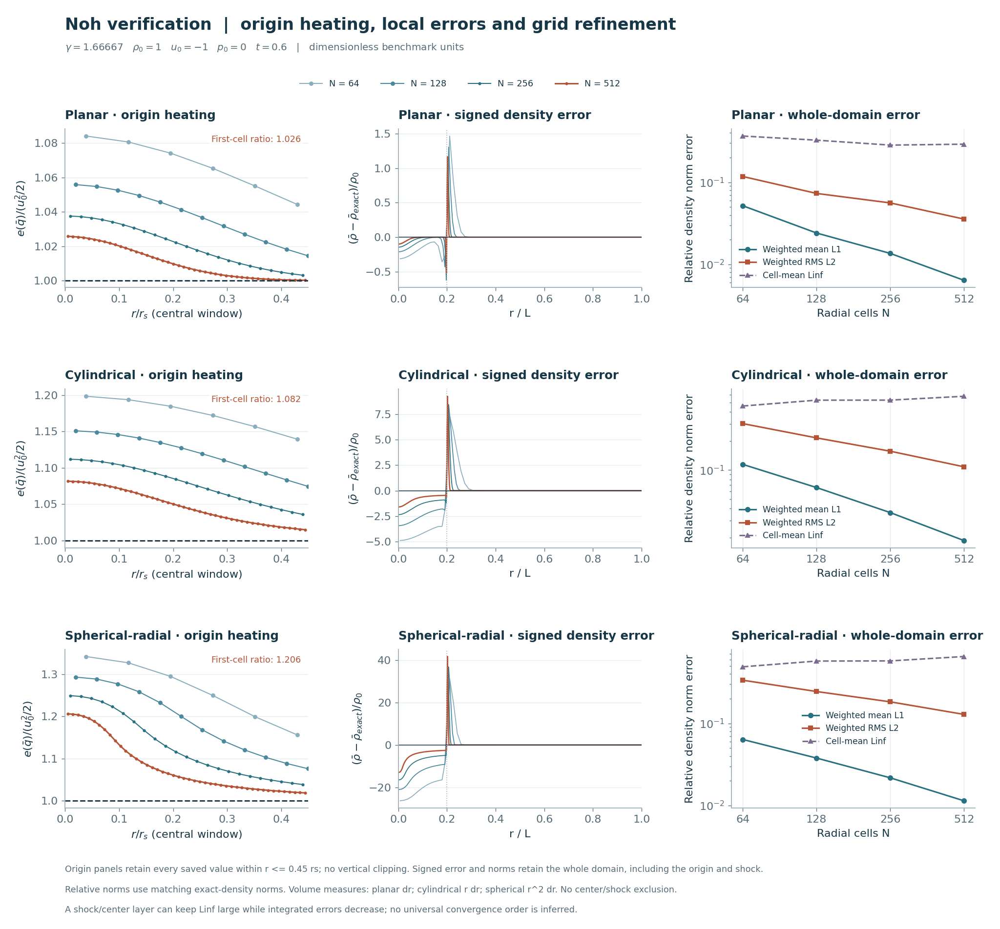

# Wall heating: numerical overheating in Noh flow and at reflecting walls

Wall heating is a localized numerical excess of specific internal energy, often accompanied by a density depression, when a strong shock forms at a reflecting wall or a convergence center. This is distinct from physical heating supplied through a wall. Existing Noh calculations illustrate how to inspect the error.

## Fix the exact post-shock state first

Use the cold ideal-gas Noh problem with gamma=5/3, initial density 1 and inward velocity −1. Here d=1 is planar, d=2 cylindrical-radial and d=3 spherical-radial. The formulas describe the uniform post-shock state r<r_s. Shock-cut cells require matching exact conserved cell means rather than point values.

Specific internal energy e is per unit mass; script E is total energy per unit volume and m is momentum density. The value e(U) formed from cell-mean conserved variables generally differs from the exact cell mean of e. Retain the quantity defined in each saved figure.

$$
\gamma=5/3,\quad \rho_0=1,\quad u_0=-1,\quad p_0=0:\quad r_s=t/3,\quad(\rho,p,u)_2=(4^d,4^d/3,0),\quad e_2=1/2
$$

$$
e(U)=\frac{\mathcal E}{\rho}-\frac{|\boldsymbol m|^2}{2\rho^2},\qquad \delta_e=\frac{e(U)}{e_2}-1,\quad\delta_\rho=\frac{\rho}{\rho_2}-1
$$

## Separate local error, its spatial extent and whole-domain error

In a fixed physical region including the center, inspect maximum specific-energy excess, minimum density and integrated density error together. Measure the shock layer separately; excluding the center does not establish whole-domain accuracy.

The saved figure uses the existing 64/128/256/512 grids. Left: specific internal energy within r<=0.45r_s. Center: signed density error on the whole domain. Right: whole-domain L1/L2/Linf. Open the image to zoom. Spherical volume weighting r² downweights a small central defect, so inspect local maxima as well as integral norms.

## What the saved measurements establish

Saved maximum center specific-internal-energy excesses at N=512 in edition 2026-11-23-r5 are 2.58% planar, 8.16% cylindrical-radial and 20.59% spherical-radial. The separate 128² Cartesian calculation in edition 2026-11-23-r2 gives 13.99%. These stored results use different reconstructions, geometries and grids; they are not a controlled ranking of methods.

The third attempt passed all 105 criteria across the geometries, yet maximum spherical center overheating increased from 15.52% in the second attempt to 20.59%. Passing the gates, improving a whole-domain norm and eliminating wall heating are different claims. Original criteria, failed attempts and saved values are retained.

[Planar/cylindrical/spherical figures, inputs, code and verification](/numerical-methods-atlas/validation/noh-shock/?lang=en) · [Actual 2D Cartesian Noh calculation and origin heating](/numerical-methods-atlas/validation/noh-cartesian-2d/?lang=en)

## Global conservation does not rule out local overheating

At a stationary impermeable reflecting wall, zero normal velocity gives zero physical Euler total-energy flux. Errors in the local kinetic/internal-energy partition and numerical entropy production can remain even when total energy is conserved. Account separately for the outer inflow of the Noh problem.

Artificial viscosity, numerical flux, reconstruction and initial stagnation treatment can affect the error. A conduction-based correction needs comparison of density, pressure, shock position, positivity and budgets under the same conditions. This chapter introduces no new correction solver or general elimination guarantee.

$$
F_{\mathcal E}=(\mathcal E+p)u_n=0\quad\hbox{at a stationary impermeable reflecting wall}
$$

## Sources and the scope checked here

Noh (1987) is cited for the problem and wall-heating error. The publisher bibliography and abstract were checked; no full-text audit or reproduction of every original figure is claimed. The pinned LANL ExactPack analytic evaluator independently checks exact states; it is not an independent PDE solver.

This chapter interprets data in existing public releases. It adds no new PDE execution, acceptance change, physical test problem or execution example.

## Fixed-input examples and diagnostic controls

Distinguish the scope established by acceptance checks from a general mathematical guarantee; preserve historical inputs, measurements and criteria.

### Noh shocks: zero-pressure planar, cylindrical and spherical flow

Fixed-target computation

An original small 1D finite-volume code solves zero-pressure Noh flow in planar, cylindrical and spherical symmetry. Grids 64/128/256/512 measure full-domain error, origin heating, shock location and budgets, and compare spherical boundary-inflow time-quadrature error with its analytic identity.

An educational calculation: first-order space in planar/cylindrical flow and MUSCL-type limited linear reconstruction in spherical flow. Origin heating and finite-grid plateau errors remain; the center is never removed from whole-domain error. Because r^2 weighting can make central defects appear small, an origin-inclusive fixed-core norm and enlarged view are also shown. Vanishing Linf/center maximum error, high order for the complete method on smooth spherical problems, general stage positivity with the geometric source, Cartesian multidimensional flow and independent arbitrary-gamma validation are not established. Cylindrical Linf was not monotone in the old series; spherical L2/Linf and heating are retained as diagnostics. Roundoff-scale discrete mass/energy balance coexists with O(dt^2) spherical boundary-time-quadrature error against analytic totals. Radial momentum has a geometric source and is not a conserved Cartesian momentum component. ExactPack independently implements the analytic evaluator, not another numerical PDE engine.

[Input, results and acceptance](/numerical-methods-atlas/validation/noh-shock/?lang=en) · [Method and sources](/numerical-methods-atlas/en/read/validation-noh/#noh-shock) · [Code run.py](https://hrkoyama.github.io/code/validated-examples/2026-11-23-r5/noh/run.py) · [Code noh_solver.py](https://hrkoyama.github.io/code/validated-examples/2026-11-23-r5/noh/noh_solver.py) · [Code noh_reference.py](https://hrkoyama.github.io/code/validated-examples/2026-11-23-r5/noh/noh_reference.py) · [Code generate_exactpack_reference.py](https://hrkoyama.github.io/code/validated-examples/2026-11-23-r5/noh/generate_exactpack_reference.py) · [Code plot_noh.py](https://hrkoyama.github.io/code/validated-examples/2026-11-23-r5/noh/plot_noh.py) · [Tests test_noh.py](https://hrkoyama.github.io/code/validated-examples/2026-11-23-r5/noh/test_noh.py) · [ZIP](/code/validated-examples/2026-11-23-r5/noh/atlas-noh-2026-11-23-r5.zip) · [Results](/code/validated-examples/2026-11-23-r5/noh/results/result.json) · [Rerun receipt](/code/validated-examples/2026-11-23-r5/noh/verification.json)

### Noh problem: an actual 2D Cartesian Euler calculation

Fixed-target computation

A small 2D Euler finite-volume calculation evolves density, both momenta and total energy over the full square. Three grids,32²/64²/128², measure Noh-reference errors, budgets and grid orientation effects. The picture shows the actual evolved 2D array.

A first-order-space lightweight example retains origin heating and shock errors. Finest maximum center specific internal energy is still about 14% high. Axis/diagonal shock-radius difference is about .501dx and is not monotone over these grids. Roundoff-level D4 parity does not establish exact circular symmetry. General perturbation stability, displaced origins, rotated meshes, 3D Cartesian flow and high-order accuracy are unverified. Earlier planar/cylindrical/spherical 1D editions and gates remain unchanged.

[Input, results and acceptance](/numerical-methods-atlas/validation/noh-cartesian-2d/?lang=en) · [Method and sources](/numerical-methods-atlas/en/read/validation-noh-cartesian/#noh-cartesian-2d) · [Code run.py](https://hrkoyama.github.io/code/validated-examples/2026-11-23-r2/noh-cartesian/run.py) · [Code cartesian_solver.py](https://hrkoyama.github.io/code/validated-examples/2026-11-23-r2/noh-cartesian/cartesian_solver.py) · [Code cartesian_reference.py](https://hrkoyama.github.io/code/validated-examples/2026-11-23-r2/noh-cartesian/cartesian_reference.py) · [Tests test_cartesian.py](https://hrkoyama.github.io/code/validated-examples/2026-11-23-r2/noh-cartesian/test_cartesian.py) · [ZIP](/code/validated-examples/2026-11-23-r2/noh-cartesian/atlas-noh-cartesian-2026-11-23-r2.zip) · [Results](/code/validated-examples/2026-11-23-r2/noh-cartesian/results/result.json) · [Rerun receipt](/code/validated-examples/2026-11-23-r2/noh-cartesian/verification.json)

## Publication scope

An explanatory chapter preserving the existing Noh releases, figures, inputs, references and verification history. These examples measure wall heating; they do not eliminate it.

## Sources

- W. F. Noh (1987). Errors for calculations of strong shocks using an artificial viscosity and an artificial heat flux. https://doi.org/10.1016/0021-9991(87)90074-X
- J. Thrussell and J. M. Ferguson (2023). ExactPack: A python library of exact analytic solutions. https://doi.org/10.1016/j.softx.2023.101560
