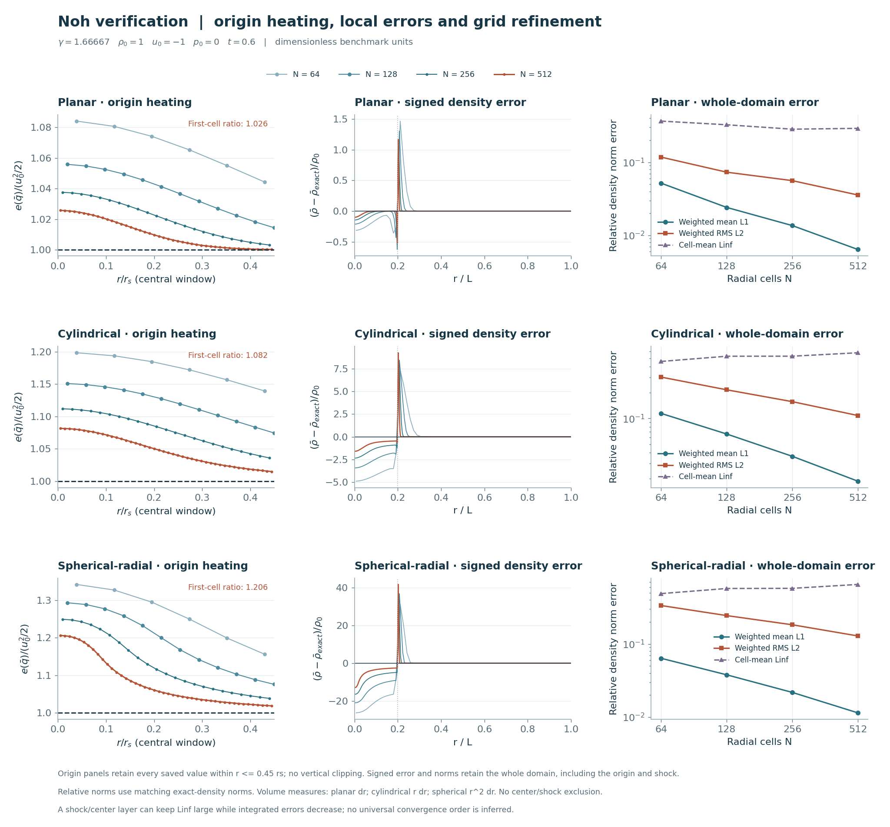

# Wall heating：Noh問題と反射壁の数値的な過熱

Wall heatingは、強い衝撃が反射壁や流れの収束中心から形成されるとき、数値解に局所的な比内部エネルギーの過大や密度のくぼみが残る現象です。ここでは外部から壁を加熱する物理過程と区別し、既存のNoh計算を使って誤差の見方を説明します。

## まず衝撃後の厳密状態を固定する

初期圧力ゼロの理想気体Noh問題で、γ=5/3、初期密度1、内向き速度−1を使います。d=1は平面、d=2は円筒半径対称、d=3は球半径対称です。下式は衝撃の後ろの一定状態で、r<r_sに適用します。衝撃をまたぐセルでは、保存量の厳密セル平均を使い、点値と取り違えません。

比内部エネルギーeは単位質量当たり、𝓔は単位体積当たりの全エネルギー、mは運動量密度です。セル平均保存量Uから求めたe(U)と、eの厳密セル平均は一般に異なります。今回の既存図の量の定義を保ちます。

$$
\gamma=5/3,\quad \rho_0=1,\quad u_0=-1,\quad p_0=0:\quad r_s=t/3,\quad(\rho,p,u)_2=(4^d,4^d/3,0),\quad e_2=1/2
$$

$$
e(U)=\frac{\mathcal E}{\rho}-\frac{|\boldsymbol m|^2}{2\rho^2},\qquad \delta_e=\frac{e(U)}{e_2}-1,\quad\delta_\rho=\frac{\rho}{\rho_2}-1
$$

## 局所誤差・誤差領域・全域誤差を分ける

中心を含む固定した物理領域で、比内部エネルギーの最大過剰、密度の最小値、密度の積分誤差を並べます。衝撃近傍の誤差は別に測り、中心だけを除いて全域精度がよいとは判定しません。

下の保存図は64/128/256/512格子の既存結果です。左列はr≤0.45r_sの比内部エネルギー、中央列は全域の符号付き密度誤差、右列は全域のL1/L2/L∞です。図を開くと拡大できます。球では体積重みr²が中心の小さな欠陥を弱く数えるため、局所最大誤差と積分ノルムを両方見ます。

## 既存の測定で何がわかるか

既存の2026-11-23-r5版・N=512の中心最大比内部エネルギーの相対過剰は、平面2.58%、円筒半径対称8.16%、球半径対称20.59%です。別の2026-11-23-r2版・128² Cartesian計算では13.99%です。異なる再構築・幾何・格子の保存値であり、方式の優劣をそろえた比較ではありません。

第3試行は全幾何を含む105条件すべてに合格していますが、球の中心最大過熱は第2試行の15.52%から20.59%へ増えています。「合格」「全域誤差の改善」「wall heatingの解消」を同じ意味にはしません。元の受入基準・失敗試行・保存値を保持します。

[平面・円筒・球の図、固定入力、コード、検証記録](/numerical-methods-atlas/validation/noh-shock/?lang=ja) · [実際の2D Cartesian Noh計算と原点過熱](/numerical-methods-atlas/validation/noh-cartesian-2d/?lang=ja)

## 総量保存だけでは過熱を否定できない

静止した不透過の反射壁では法線速度がゼロなので、Eulerの物理的な全エネルギー流束はゼロです。局所的な運動・内部エネルギーの配分誤差や数値的なエントロピー生成は、総量が保存されても残り得ます。Nohの外側境界からの流入は別に収支へ数えます。

人工粘性・数値流束・再構築・初期の停滞処理などが結果に影響します。熱伝導などの補正を比較するときは、密度と圧力、衝撃位置、正値性、保存収支も同じ条件で確認します。本章は補正法の新実装や一般的な除去保証を示しません。

$$
F_{\mathcal E}=(\mathcal E+p)u_n=0\quad\hbox{at a stationary impermeable reflecting wall}
$$

## 出典と今回確認した範囲

Noh（1987）は問題とwall-heating誤差の原著として引用します。出版社の書誌・抄録を確認した範囲で、原著全文や全図の再現を主張しません。固定したLANL ExactPackの解析評価器は独立な厳密状態の照合に使われたもので、独立のPDE計算コードではありません。

本章は公開済み配布の保存データを読み解く解説です。新しい数値計算、受入基準の変更、問題数・実行例数の追加はありません。

## 固定入力の実行例と診断対照

受入条件が示す検証範囲と数学的な一般保証を区別します。旧版の入力・測定・公差は保持します。

### Noh衝撃波：初期圧力ゼロの平面・円筒・球対称計算

固定標的の計算例

初期圧力ゼロのNoh問題を、独自の小型1D有限体積コードで平面・円筒・球対称に計算します。64/128/256/512格子の全域誤差、原点過熱、衝撃位置、保存収支を測り、球で現れる境界流入の時間積分誤差を解析式と照合します。

平面・円筒は空間一次、球はMUSCL型の制限線形再構築を使う教育用計算です。原点過熱と有限格子のplateau誤差が残り、全域誤差から原点を除外しません。r²重みで中心欠陥が小さく見えるため、原点を含む固定coreの誤差と拡大図も示します。L∞や中心最大誤差のゼロ収束、滑らかな球問題での方式全体の高次精度、幾何源付き全RK段階の一般の正値性保証、Cartesian多次元、任意γの独立照合は検証していません。円筒L∞は旧系列で単調減少せず、球のL2/L∞と過熱も診断値として保持します。球の離散質量・エネルギー収支が丸め誤差でも、解析総量との差は境界時間求積のO(dt²)となります。半径方向の運動量には幾何源があり、保存されるCartesian運動量とは異なります。ExactPackは解析評価器の独立実装で、別の数値PDEエンジンではありません。

[入力・結果・受入条件](/numerical-methods-atlas/validation/noh-shock/?lang=ja) · [手法・一次文献](/numerical-methods-atlas/ja/read/validation-noh/#noh-shock) · [コード run.py](https://hrkoyama.github.io/code/validated-examples/2026-11-23-r5/noh/run.py) · [コード noh_solver.py](https://hrkoyama.github.io/code/validated-examples/2026-11-23-r5/noh/noh_solver.py) · [コード noh_reference.py](https://hrkoyama.github.io/code/validated-examples/2026-11-23-r5/noh/noh_reference.py) · [コード generate_exactpack_reference.py](https://hrkoyama.github.io/code/validated-examples/2026-11-23-r5/noh/generate_exactpack_reference.py) · [コード plot_noh.py](https://hrkoyama.github.io/code/validated-examples/2026-11-23-r5/noh/plot_noh.py) · [テスト test_noh.py](https://hrkoyama.github.io/code/validated-examples/2026-11-23-r5/noh/test_noh.py) · [ZIP](/code/validated-examples/2026-11-23-r5/noh/atlas-noh-2026-11-23-r5.zip) · [結果](/code/validated-examples/2026-11-23-r5/noh/results/result.json) · [追試記録](/code/validated-examples/2026-11-23-r5/noh/verification.json)

### Noh問題：実際の2次元Cartesian Euler計算

固定標的の計算例

正方形の全域で密度・2成分運動量・全エネルギーを更新する、小型の2次元Euler有限体積計算です。32²・64²・128²の3格子で厳密Noh状態からの誤差・保存収支・格子方向の影響を測ります。図は実際の2次元保存配列で、1D半径解の回転表示ではありません。

空間一次の軽量例で、原点過熱と衝撃層の誤差が残ります。最細格子でも中心最大比内部エネルギーは厳密値より約14%高いままです。軸・対角の衝撃半径差は約.501Δxで、3格子間で単調には減りません。D4偶奇性が丸め誤差でも円対称性が厳密という意味ではありません。一般の摂動安定性・原点位置ずらし・回転格子・3D Cartesian・高次精度は未検証です。旧1D平面/円筒/球の配布版と判定は変更しません。

[入力・結果・受入条件](/numerical-methods-atlas/validation/noh-cartesian-2d/?lang=ja) · [手法・一次文献](/numerical-methods-atlas/ja/read/validation-noh-cartesian/#noh-cartesian-2d) · [コード run.py](https://hrkoyama.github.io/code/validated-examples/2026-11-23-r2/noh-cartesian/run.py) · [コード cartesian_solver.py](https://hrkoyama.github.io/code/validated-examples/2026-11-23-r2/noh-cartesian/cartesian_solver.py) · [コード cartesian_reference.py](https://hrkoyama.github.io/code/validated-examples/2026-11-23-r2/noh-cartesian/cartesian_reference.py) · [テスト test_cartesian.py](https://hrkoyama.github.io/code/validated-examples/2026-11-23-r2/noh-cartesian/test_cartesian.py) · [ZIP](/code/validated-examples/2026-11-23-r2/noh-cartesian/atlas-noh-cartesian-2026-11-23-r2.zip) · [結果](/code/validated-examples/2026-11-23-r2/noh-cartesian/results/result.json) · [追試記録](/code/validated-examples/2026-11-23-r2/noh-cartesian/verification.json)

## 公開範囲

既存のNoh配布版・図・入力・参照・検証履歴を保持した説明章です。Wall heatingを測定する例であり、解消した例ではありません。

## 文献

- W. F. Noh (1987). Errors for calculations of strong shocks using an artificial viscosity and an artificial heat flux. https://doi.org/10.1016/0021-9991(87)90074-X
- J. Thrussell and J. M. Ferguson (2023). ExactPack: A python library of exact analytic solutions. https://doi.org/10.1016/j.softx.2023.101560
